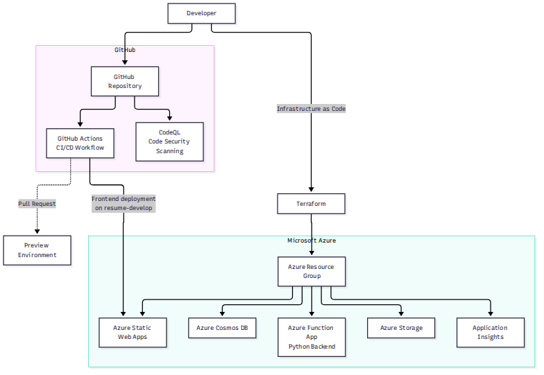

# Azure Cloud Resume Challenge

A personal cloud engineering project demonstrating how to build, deploy, secure and monitor a serverless portfolio website using Microsoft Azure.

**Live Portfolio (custom domain):** https://aniketpawar.is-a.dev

**Azure Static Web Apps fallback URL:** https://gentle-glacier-047897600.3.azurestaticapps.net

**GitHub Repository:** https://github.com/712Aniket/azure-cloud-resume-challenge

---

## 1. Project Overview

This project implements a cloud-hosted personal portfolio website with a serverless visitor counter and event-tracking capabilities.

The frontend is hosted on Azure Static Web Apps. A Python-based Azure Function handles visitor-counter requests and stores counter data in Azure Cosmos DB. The frontend also records resume and certificate view/download events and portfolio appreciation/engagement events.

Terraform configuration is maintained in the repository for Azure infrastructure. GitHub Actions automates the Static Web Apps frontend deployment; the Python Function App backend is published separately using Azure Functions Core Tools.

**Branch/deployment boundary:** the Static Web Apps workflow in this repository triggers on pushes to `main`. The later Project 2 backend extension source (portfolio analytics and protected cost-cache endpoints) is maintained on the `resume-develop` branch. The Function App is a shared live resource; the Static Web Apps workflow does not deploy the Python backend.

## 2. Architecture

The application architecture consists of the frontend, backend API, database and supporting Azure services.

### Application Architecture


### Infrastructure and Deployment Architecture



## 3. Technology Stack

| Category | Technology |
|---|---|
| Frontend | HTML5, CSS3, JavaScript |
| Frontend Hosting | Azure Static Web Apps |
| Backend | Azure Functions |
| Backend Language | Python 3.11 |
| Database | Azure Cosmos DB (SQL API) |
| Storage | Azure Storage Account |
| Infrastructure as Code | Terraform |
| CI/CD | GitHub Actions |
| Identity and Access | Microsoft Entra ID, Managed Identity, Azure RBAC |
| Monitoring | Application Insights, Azure Monitor |
| Source Control | Git and GitHub |
| Security Scanning | GitHub CodeQL |
| Dependency Management | Dependabot |

## 4. Azure Resources

The project uses the following Azure resources:

| Resource | Purpose |
|---|---|
| Azure Resource Group | Logical grouping of project resources |
| Azure Static Web Apps | Hosts the portfolio frontend |
| Azure Function App | Runs the Python visitor counter API |
| Azure Functions Service Plan | Provides serverless compute |
| Azure Cosmos DB | Stores visitor counter data |
| Azure Storage Account | Provides Azure Functions runtime storage |
| Application Insights | Collects application telemetry |

The Cosmos DB account has Free Tier enabled. Other Azure resources may incur charges depending on usage and configuration.

## 5. Visitor Counter Implementation

The portfolio includes a dynamic visitor counter powered by Azure Functions and Azure Cosmos DB.

### Request Flow

1. A visitor opens the portfolio website.
2. The frontend sends a GET request to the Azure Function API.
3. The Python HTTP-triggered function receives the request.
4. The function connects to Azure Cosmos DB using Managed Identity.
5. The visitor counter is incremented.
6. The updated count is returned as a JSON response.
7. The frontend renders country-level visitor aggregates when the API returns them. The overall aggregate visit total is intentionally not displayed in the public portfolio UI.

### API Endpoint

```http
GET /api/visitor-count
```

### Sample JSON Response

```json
{
  "visitor_count": 123
}
```

The counter uses an atomic increment operation in Cosmos DB to update the stored visitor count.

If the counter document does not exist, the function creates it. It also handles a concurrent document-creation scenario.

## 6. Identity and Security

Security is implemented using Azure-native identity and access management capabilities.

### Managed Identity

The Azure Function App uses a system-assigned Managed Identity to access Azure resources.

This avoids storing database credentials directly in application code.

### Azure RBAC

Azure role assignments provide the Function App identity with the required permissions to access Cosmos DB and Azure Storage.

### Additional Security Measures

- Function App HTTPS-only is enabled; HTTP health requests were verified to redirect to HTTPS.
- Storage Account HTTPS-only access is enabled and its minimum TLS version is configured as 1.2.
- Function App system-assigned Managed Identity is used for Cosmos DB and Function host storage access.
- Cosmos DB local/key authentication is disabled (`disableLocalAuth=true`).
- Cosmos DB SQL RBAC grants the Function App identity the built-in Data Contributor role scoped to the `portfolio-db/visitor-counters` container.
- Cosmos DB selected-network firewall contains 31 specific IP entries plus the `0.0.0.0` Azure-datacenter exception (32 rules total).
- CORS is configured for browser access from the portfolio origin.
- GitHub Secrets are used for the Static Web Apps deployment token.
- GitHub CodeQL workflow and Dependabot configuration are present in the repository.

**Network-security caveat:** The Cosmos DB `0.0.0.0` rule permits network connection attempts from Azure datacenters generally, not only from this Function App. Cosmos DB still requires Microsoft Entra ID authorization because local/key authentication is disabled.

**API authorization:** Visitor-facing routes (`health`, `visitor-count`, `portfolio-event`, and `portfolio-engagement`) use anonymous Function authorization because the public website needs them. The Project 2 extension routes `cost-analytics` and `cost-cache-refresh` require a Function key. The aggregated `portfolio-analytics` route is anonymous for the Azure Workbook. Managed Identity protects server-to-service access; it does not authenticate visitors. CORS is a browser control, not API authentication.

**Residual risk:** The Function App identity has account-scope `Storage Blob Data Owner` access on `aniketportfolio07`, which also stores Terraform remote state. This is broader than a cache-only permission and could allow the Function App identity to access Terraform state. Storage separation was deferred; review this before reusing or decommissioning the shared account.

## 7. API and Analytics Capabilities

The core Project 1 backend contains the following public website endpoints:

| Endpoint | Purpose | Authorization |
|---|---|---|
| `GET /api/health` | Health status for monitoring | Anonymous |
| `GET /api/visitor-count` | Update/read visitor-counter aggregates | Anonymous |
| `POST /api/portfolio-event` | Record resume and certificate views/downloads | Anonymous |
| `POST /api/portfolio-engagement` | Record daily likes/appreciations and accepts session/section engagement event types | Anonymous |

The frontend records:
- Resume views and downloads through `resume-viewer.js`.
- Certificate views and downloads through `app.js`.
- Portfolio appreciation through `portfolio-like.js`.
- Session and section-view/section-time events through `engagement-analytics.js`.

The Project 2 extension adds the following functions to the same live Function App. Their latest source is maintained on the `resume-develop` branch:

| Endpoint / trigger | Purpose | Authorization |
|---|---|---|
| `GET /api/portfolio-analytics` | Return aggregated visitor, resume, certificate and portfolio engagement metrics for the Azure Workbook | Anonymous, read-only aggregate response |
| `GET /api/cost-analytics` | Read the cached cost snapshot | Function key |
| `POST /api/cost-cache-refresh` | On-demand cost cache refresh | Function key |
| `daily_cost_cache_refresh` | Scheduled daily cost cache refresh | Timer trigger |

The Azure Workbook's cost panels query Azure Cost Management through the Workbook ARM endpoint directly; they do not depend on the `/api/cost-analytics` function endpoint.

Source for the Project 2 API extension: [`resume-develop/api`](https://github.com/712Aniket/azure-cloud-resume-challenge/tree/resume-develop/api). This extension source has been deployed to the shared live Function App, but has not yet been promoted into the `main` branch.

## 8. Infrastructure as Code – Terraform

Terraform is used to define and manage the Azure infrastructure.

Infrastructure configuration is maintained in the `terraform/` directory.

The configuration covers resources including:

- Azure Resource Group
- Azure Storage Account
- Azure Cosmos DB account
- Cosmos DB SQL database and container
- Azure Functions Service Plan
- Azure Static Web Apps
- Application Insights
- Required identity and access role assignments

Terraform makes the declared infrastructure configuration repeatable and easier to maintain. The repository includes both resource-specific configuration and generated import configuration in `terraform/generated-imports.tf`.

Sensitive configuration and Terraform state files are excluded from source control. The reviewed Project 1 Terraform directory does not include a tracked `backend.tf` file; therefore, this README does not claim that Project 1's own Terraform state is configured with a remote backend.

**Drift warning:** The generated Terraform import snapshot currently records the Function App's `https_only` setting as `false`, while the live Function App was subsequently hardened to `httpsOnly=true`. The live Cosmos DB local-authentication and firewall changes were also applied through Azure/Portal operations and are not fully represented by the checked-in Terraform configuration. Review and reconcile Terraform configuration and state before any future `terraform apply`; an unreviewed apply could reintroduce weaker settings.

## 8. CI/CD – GitHub Actions

GitHub Actions automates the frontend deployment process.

### Workflow Configuration

Workflow file:

```text
.github/workflows/azure-static-web-apps-gentle-glacier-047897600.yml
```

### Deployment Process

1. A developer pushes changes to the `main` branch.
2. GitHub Actions starts the Static Web Apps workflow.
3. The repository is checked out using GitHub Actions.
4. The Azure Static Web Apps deployment action builds and deploys the `./frontend` folder.
5. The updated frontend becomes available through Azure Static Web Apps.

### Workflow Details

| Configuration | Value |
|---|---|
| CI/CD Platform | GitHub Actions |
| Runner | Ubuntu Latest |
| Trigger Branch | main |
| Deployment Target | Azure Static Web Apps |
| Frontend Location | `./frontend` |
| Deployment Action | Azure/static-web-apps-deploy@v1 |
| Deployment Authentication | GitHub Secret |

### Pull Request Preview

The checked-in Static Web Apps workflow does not declare a `pull_request` trigger. Pull-request preview deployment is therefore not claimed as a configured workflow.

### Backend Deployment

The Static Web Apps workflow described above deploys the frontend only. It does not deploy the Python Azure Functions backend.

## 9. Repository Structure

```text
azure-cloud-resume-challenge/
│
├── .github/
│   └── workflows/
│       ├── azure-static-web-apps-gentle-glacier-047897600.yml
│       └── codeql.yml
│
├── api/
│   ├── function_app.py
│   ├── host.json
│   └── requirements.txt
│
├── docs/
│   ├── architecture.mmd
│   ├── architecture.png
│   ├── deployment-architecture.mmd
│   └── deployment-architecture.png
│
├── frontend/
│   ├── index.html
│   ├── compact.html
│   ├── app.js
│   ├── land.js
│   ├── style.css
│   ├── engagement-analytics.js
│   ├── portfolio-like.js
│   ├── resume-viewer.js
│   ├── resume-viewer.css
│   ├── view-transition.js
│   ├── view-transition.css
│   ├── css/
│   ├── js/
│   └── assets/
│
├── infrastructure/
│
├── terraform/
│   ├── main.tf
│   ├── functionapp.tf
│   ├── cosmos.tf
│   ├── storage.tf
│   ├── staticwebapp.tf
│   ├── variables.tf
│   ├── providers.tf
│   └── generated-imports.tf
│
├── .gitignore
└── README.md
```

## 10. Monitoring and Observability

Application Insights is integrated with the Azure Function App to collect application telemetry.

It supports monitoring and diagnostics of application requests and runtime behaviour.

The integration provides a foundation for investigating application issues and understanding backend activity.

## 11. Challenges and Technical Learning

During development, the following areas were explored:

- Hosting a static website using Azure Static Web Apps.
- Developing a serverless backend using Python and Azure Functions.
- Connecting Azure Functions to Cosmos DB.
- Implementing atomic counter updates.
- Configuring Managed Identity and Azure RBAC.
- Managing Azure resources using Terraform.
- Automating frontend deployment using GitHub Actions.
- Configuring application telemetry using Application Insights.
- Applying GitHub security features such as CodeQL and Dependabot.
- Managing development and stable branches using Git.

## 12. Future Improvements

Potential next improvements include:

- Add a tested GitHub Actions deployment workflow for the Python Function App with protected approvals and rollback-aware release handling.
- Add automated unit, integration and API contract tests for the Python Functions.
- Reconcile the Terraform configuration with live HTTPS-only, Cosmos DB authentication and firewall settings before using Terraform for further changes.
- Consider a narrower, stable-egress network design (for example, VNet integration with controlled egress) if budget and hosting constraints justify it.
- Separate Function runtime/cache storage from Terraform state storage to reduce the impact of a compromised Function App identity.
- Add an explicit Azure budget and alert policy if cost governance notifications are required.
- Continue improving rate limiting, abuse protection and API monitoring for anonymous visitor-facing endpoints.

## 13. Project Status

**Status: Completed – Core Portfolio Scope and Live Backend Integration**

The public portfolio frontend, serverless visitor counter, resume/certificate event capture, portfolio appreciation/engagement event capture, Azure infrastructure configuration, frontend CI/CD workflow, and core security controls are in place.

The additional Project 2 analytics and cost API functions have been deployed to the shared Function App from the `resume-develop` source branch. The latest API extension source has not yet been merged into `main`; the Static Web Apps frontend workflow continues to deploy from `main`.

The README documents the current live configuration as verified during the November 2026 security review. Future changes should reconcile Terraform drift before applying infrastructure changes.
