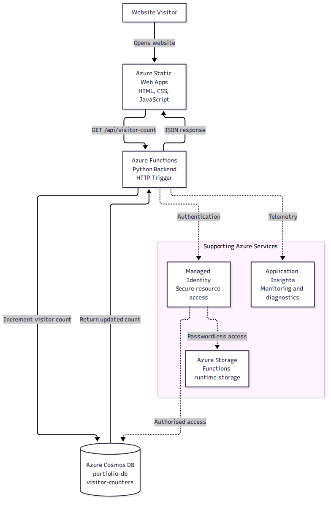
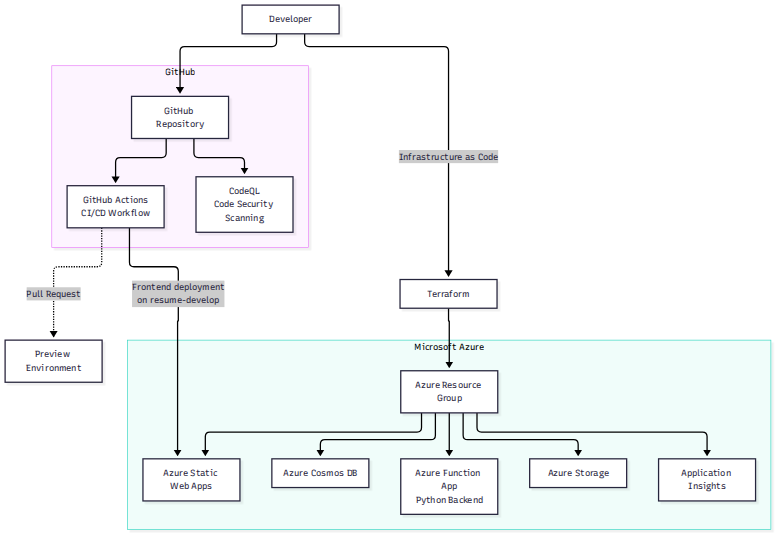

# Azure Cloud Resume Challenge

A personal cloud engineering project demonstrating how to build, deploy, secure and monitor a serverless portfolio website using Microsoft Azure.

**Live Portfolio:** https://gentle-glacier-047897600.3.azurestaticapps.net

**GitHub Repository:** https://github.com/712Aniket/azure-cloud-resume-challenge

---

## 1. Project Overview

This project implements a cloud-hosted personal portfolio website with a serverless visitor counter.

The frontend is hosted on Azure Static Web Apps. A Python-based Azure Function handles visitor counter requests and stores the counter in Azure Cosmos DB.

Terraform is used to manage Azure infrastructure, while GitHub Actions automates frontend deployment.

The project demonstrates practical experience with cloud infrastructure, serverless computing, Infrastructure as Code (IaC), CI/CD, identity management and application monitoring.

## 2. Architecture

The application architecture consists of the frontend, backend API, database and supporting Azure services.

### Application Architecture



### Infrastructure and Deployment Architecture



## 3. Technology Stack

| Category | Technology |
|---|---|
| Frontend | HTML5, CSS3, JavaScript |
| Frontend Hosting | Azure Static Web Apps |
| Backend | Azure Functions |
| Backend Language | Python 3.11 |
| Database | Azure Cosmos DB (SQL API) |
| Storage | Azure Storage Account |
| Infrastructure as Code | Terraform |
| CI/CD | GitHub Actions |
| Identity and Access | Microsoft Entra ID, Managed Identity, Azure RBAC |
| Monitoring | Application Insights, Azure Monitor |
| Source Control | Git and GitHub |
| Security Scanning | GitHub CodeQL |
| Dependency Management | Dependabot |

## 4. Azure Resources

The project uses the following Azure resources:

| Resource | Purpose |
|---|---|
| Azure Resource Group | Logical grouping of project resources |
| Azure Static Web Apps | Hosts the portfolio frontend |
| Azure Function App | Runs the Python visitor counter API |
| Azure Functions Service Plan | Provides serverless compute |
| Azure Cosmos DB | Stores visitor counter data |
| Azure Storage Account | Provides Azure Functions runtime storage |
| Application Insights | Collects application telemetry |

The Cosmos DB account has Free Tier enabled. Other Azure resources may incur charges depending on usage and configuration.

## 5. Visitor Counter Implementation

The portfolio includes a dynamic visitor counter powered by Azure Functions and Azure Cosmos DB.

### Request Flow

1. A visitor opens the portfolio website.
2. The frontend sends a GET request to the Azure Function API.
3. The Python HTTP-triggered function receives the request.
4. The function connects to Azure Cosmos DB using Managed Identity.
5. The visitor counter is incremented.
6. The updated count is returned as a JSON response.
7. The frontend displays the visitor count.

### API Endpoint

```http
GET /api/visitor-count
```

### Sample JSON Response

```json
{
  "visitor_count": 123
}
```

The counter uses an atomic increment operation in Cosmos DB to update the stored visitor count.

If the counter document does not exist, the function creates it. It also handles a concurrent document-creation scenario.

## 6. Identity and Security

Security is implemented using Azure-native identity and access management capabilities.

### Managed Identity

The Azure Function App uses a system-assigned Managed Identity to access Azure resources.

This avoids storing database credentials directly in application code.

### Azure RBAC

Azure role assignments provide the Function App identity with the required permissions to access Cosmos DB and Azure Storage.

### Additional Security Measures

- HTTPS-only access for the Storage Account.
- Minimum TLS version configured as 1.2 for Storage.
- Managed Identity for passwordless Azure resource access.
- CORS configuration for the portfolio website origin.
- GitHub Secrets for the Static Web Apps deployment token.
- GitHub CodeQL for source-code security scanning.
- Dependabot for dependency monitoring and updates.
- GitHub push protection to help prevent accidental secret exposure.

**Note:** The visitor counter HTTP endpoint uses anonymous authorization. Visitors do not need to authenticate to access the counter API. Managed Identity protects the Function App's access to Azure resources; it does not authenticate website visitors. CORS is a browser security mechanism, not an API authentication mechanism.

## 7. Infrastructure as Code – Terraform

Terraform is used to define and manage the Azure infrastructure.

Infrastructure configuration is maintained in the `terraform/` directory.

The configuration covers resources including:

- Azure Resource Group
- Azure Storage Account
- Azure Cosmos DB account
- Cosmos DB SQL database and container
- Azure Functions Service Plan
- Azure Static Web Apps
- Application Insights
- Required identity and access role assignments

Terraform makes the infrastructure configuration repeatable and easier to maintain.

Sensitive configuration and Terraform state files are excluded from source control.

## 8. CI/CD – GitHub Actions

GitHub Actions automates the frontend deployment process.

### Workflow Configuration

Workflow file:

```text
.github/workflows/azure-static-web-apps-gentle-glacier-047897600.yml
```

### Deployment Process

1. A developer pushes changes to the `resume-develop` branch.
2. GitHub Actions starts the workflow.
3. The repository is checked out using GitHub Actions.
4. The Azure Static Web Apps deployment action builds and deploys the frontend.
5. The updated website becomes available through Azure Static Web Apps.

### Workflow Details

| Configuration | Value |
|---|---|
| CI/CD Platform | GitHub Actions |
| Runner | Ubuntu Latest |
| Trigger Branch | resume-develop |
| Deployment Target | Azure Static Web Apps |
| Frontend Location | `./frontend` |
| Deployment Action | Azure/static-web-apps-deploy@v1 |
| Deployment Authentication | GitHub Secret |

### Pull Request Preview

Pull requests targeting `resume-develop` also trigger preview deployment workflows.

When a pull request is closed, the corresponding preview environment is cleaned up.

### Backend Deployment

The Static Web Apps workflow described above deploys the frontend only. It does not deploy the Python Azure Functions backend.

## 9. Repository Structure

```text
azure-cloud-resume-challenge/
│
├── .github/
│   └── workflows/
│       ├── azure-static-web-apps-gentle-glacier-047897600.yml
│       └── codeql.yml
│
├── api/
│   ├── function_app.py
│   ├── host.json
│   └── requirements.txt
│
├── docs/
│   ├── architecture.mmd
│   ├── architecture.png
│   ├── deployment-architecture.mmd
│   └── deployment-architecture.png
│
├── frontend/
│   ├── images/
│   │   └── certificates/
│   ├── index.html
│   ├── css/
│   └── js/
│
├── infrastructure/
│
├── terraform/
│   ├── main.tf
│   ├── functionapp.tf
│   ├── cosmos.tf
│   ├── storage.tf
│   ├── staticwebapp.tf
│   ├── variables.tf
│   ├── providers.tf
│   └── generated-imports.tf
│
├── .gitignore
└── README.md
```

## 10. Monitoring and Observability

Application Insights is integrated with the Azure Function App to collect application telemetry.

It supports monitoring and diagnostics of application requests and runtime behaviour.

The integration provides a foundation for investigating application issues and understanding backend activity.

## 11. Challenges and Technical Learning

During development, the following areas were explored:

- Hosting a static website using Azure Static Web Apps.
- Developing a serverless backend using Python and Azure Functions.
- Connecting Azure Functions to Cosmos DB.
- Implementing atomic counter updates.
- Configuring Managed Identity and Azure RBAC.
- Managing Azure resources using Terraform.
- Automating frontend deployment using GitHub Actions.
- Configuring application telemetry using Application Insights.
- Applying GitHub security features such as CodeQL and Dependabot.
- Managing development and stable branches using Git.

## 12. Future Improvements

Potential enhancements include:

- Automating Python Azure Functions deployment.
- Adding automated backend tests.
- Improving application monitoring and alerting.
- Implementing additional visitor analytics.
- Configuring a custom domain.
- Further improving CI/CD security and deployment approvals.

## 13. Project Status

**Status: Completed – Core Implementation and Documentation**

The portfolio website, serverless visitor counter, Azure infrastructure configuration, frontend CI/CD workflow, security configuration and architecture documentation are in place.

Further enhancements can be implemented as separate iterations.
